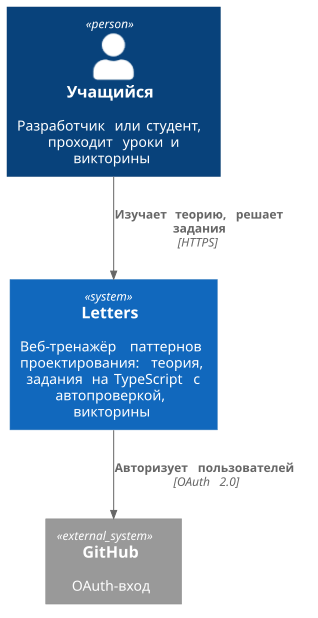
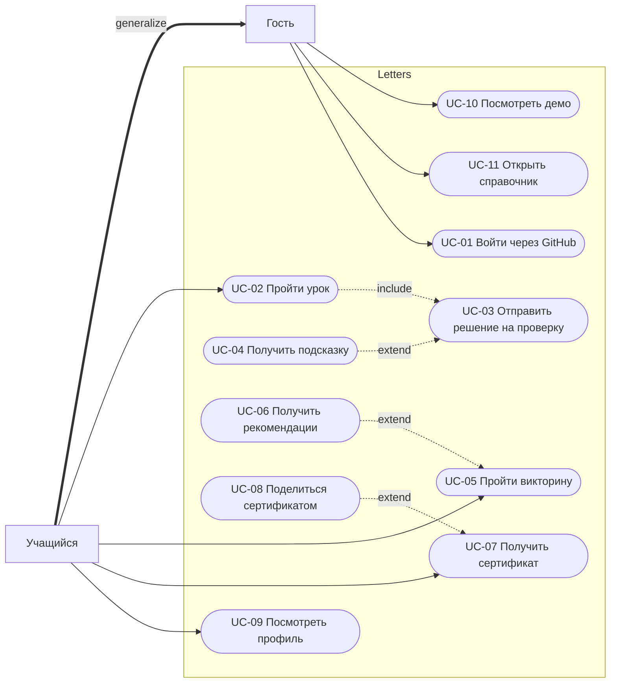

# Обозначения

Элементы Vision (в порядке упоминания в документе)

| ID | Категория | Краткое содержание |
| :--- | :--- | :--- |
| **US-1** | Пользовательская история | Начинающий разработчик |
| **US-2** | Пользовательская история | Средний разработчик |
| **US-3** | Пользовательская история | Разработчик с ИИ-агентами |
| **US-4** | Пользовательская история | Студент |
| **US-5** | Пользовательская история | Работодатель |
| **CJM-1**| Этап CJM | Потребность |
| **CJM-2**| Этап CJM | Изучение рынка |
| **CJM-3**| Этап CJM | Выбор продукта |
| **CJM-4**| Этап CJM | Удержание |
| **CJM-5**| Этап CJM | Лояльность |
| **ОГР-1**| Ограничение | Срок: конец семестра |
| **ОГР-2**| Ограничение | Простой фундамент требований |
| **ОГР-3**| Ограничение | Контент готовится заранее, без ИИ-генерации |
| **ОГР-4**| Ограничение | Ключевое обучение бесплатно |
| **ОГР-5**| Ограничение | Минимальные операционные издержки |

Система приоритетов

| Обозначение | Расшифровка (MoSCoW) |
| :---: | :--- |
| **M** | Must have (Должно быть) |
| **S** | Should have (Следовало бы иметь) |
| **C** | Could have (Можно бы иметь) |
| **W** | Won't have (Не будет реализовано) |

## Функциональные требования

| ID    | Требование | Приор. |
| ----- | ---------- | ------ |
| FR-01 | Пользователь может войти через GitHub OAuth | M |
| FR-02 | Система сохраняет пройденные уроки, результаты викторин | M |
| FR-03 | Система показывает каталог из 23 уроков, по одному на каждый паттерн проектирования. Теория и практическое задание урока находятся на одной странице | M |
| FR-04 | В теории отображается референсная UML-диаграмма классов паттерна | M |
| FR-05 | Пользователь пишет решение на TypeScript во встроенном редакторе с подсветкой синтаксиса | M |
| FR-06 | Система строит диаграмму классов по коду пользователя и показывает её рядом с референсной | S |
| FR-07 | Пользователь может запросить подсказку | S |
| FR-08 | Система проверяет структуру кода на соответсвие паттерну | M |
| FR-09 | При неудачной проверке пользователь видит понятное сообщение об ошибке | M |
| FR-10 | После каждого урока предлагается короткая викторина | M |
| FR-11 | Викторины с неочевидными вопросы типов: «паттерн по коду», «выбери паттерн для рефакторинга фрагмента» | M |
| FR-12 | По результатам викторин система рекомендует уроки для повторения | C |
| FR-13 | Задание одного паттерна может выдаваться в разных предметных областях из библиотеки доменов (CarFactory, HomeFactory и т.д.) | M |
| FR-14 | В библиотеке доменов могут быть партнёрские (рекламные) домены. Они добавляют в текст задания ненавязчивое описание сервиса во введении | M |
| FR-15 | После прохождения курса пользователь получает сертификат: PDF и публичная ссылка для проверки подлинности | S |
| FR-16 | Пользователь может поделиться сертификатом или результатом в соцсетях | C |
| FR-17 | В профиле пользователя показан прогресс по курсу | S |
| FR-18 | На лендинге есть демо-галерея: интерактивный пример задания, который работает без входа | S |
| FR-19 | Справочник: краткие карточки по каждому паттерну (суть, диаграмма, когда применять) | S |
| FR-20 | Пользователи используют TypeScript для реализации паттернов | M |

## Нефункциональные требования (NFR)

| ID     | Категория | Требование |
| ------ | --------- | ---------- |
| NFR-01 | Производительность | Проверка типового решения занимает не более 2с p95, страницы загружаются не больше 3 секунд p95 |
| NFR-02 | Стоимость | Используется архитектурный подход Client-Side Rendering |
| NFR-03 | Безопасность | Код пользователя проверяется статическим анализом либо средствами рефлексии. На сервере пользовательский код не исполняется |
| NFR-04 | Стоимость | Расходы не превышают 100 ₽/мес при 1000 активных пользователей в месяц |
| NFR-05 | Надёжность | Graceful Degradation при недоступности сервера с синхронизацией прогресса после переподключения |
| NFR-06 | Совместимость | Поддерживаются актуальные версии браузеров Chrome, Firefox и Edge. Вёрстка приложения адаптируется под мобильные устройства |
| NFR-07 | Безопасность | О пользователе храним лишь некоторые данные из GitHub профиля и прогресс, используется OAuth 2.0 |
| NFR-08 | Сопровождаемость | Новый домен для существующего задания добавляется без изменения кода платформы |

## 3. Матрица трассировки требований (RTM)

| Требование | Источник | Use case | Проверка |
| ---------- | -------- | -------- | -------- |
| FR-01 | CJM-4 | UC-01 | E2E-тест |
| FR-02 | CJM-4, US-4 | UC-01, UC-02 | E2E-тест |
| FR-03 | US-1, US-4 | UC-02 | Демонстрация |
| FR-04 | US-3 | UC-02 | Демонстрация |
| FR-05 | US-1 | UC-02 | Ручной тест |
| FR-06 | US-3 | UC-03 | Юнит-тест |
| FR-07 | CJM-4 | UC-04 | Ручной тест |
| FR-08 | US-1, US-3 | UC-03 | Юнит-тест |
| FR-09 | CJM-4 | UC-03 | Ручной тест |
| FR-10 | US-2 | UC-05 | E2E-тест |
| FR-11 | US-2, US-3 | UC-05 | Ревью контента |
| FR-12 | CJM-4 | UC-06 | Юнит-тест |
| FR-13 | CJM-4 | UC-02 | Демонстрация |
| FR-14 | ОГР-4 | UC-02 | Ревью контента |
| FR-15 | CJM-5 | UC-07 | E2E-тест |
| FR-16 | CJM-5 | UC-07 | Ручной тест |
| FR-17 | CJM-4 | UC-08 | Демонстрация |
| FR-18 | CJM-2, CJM-3 | UC-14 | Демонстрация |
| FR-19 | US-2 | UC-15 | Демонстрация |
| FR-20 | ОГР-2 | UC-02, UC-03 | Демонстрация |
| NFR-01 | CJM-3, CJM-4 | UC-03, UC-14 | Замер времени |
| NFR-02 | ОГР-5 | — | Код-ревью |
| NFR-03 | ОГР-5 | UC-03 | Код-ревью |
| NFR-04 | ОГР-5 | — | Расчёт стоимости |
| NFR-05 | CJM-4 | UC-02 | Тест с отключённым сервером |
| NFR-06 | CJM-4 | все | Ручной тест в браузерах |
| NFR-07 | CJM-3 | UC-01 | Код-ревью |
| NFR-08 | ОГР-2, ОГР-3 | UC-13 | Демонстрация |

## Диаграмма контекста (C1)

## Диаграмма вариантов использования (Use case)

